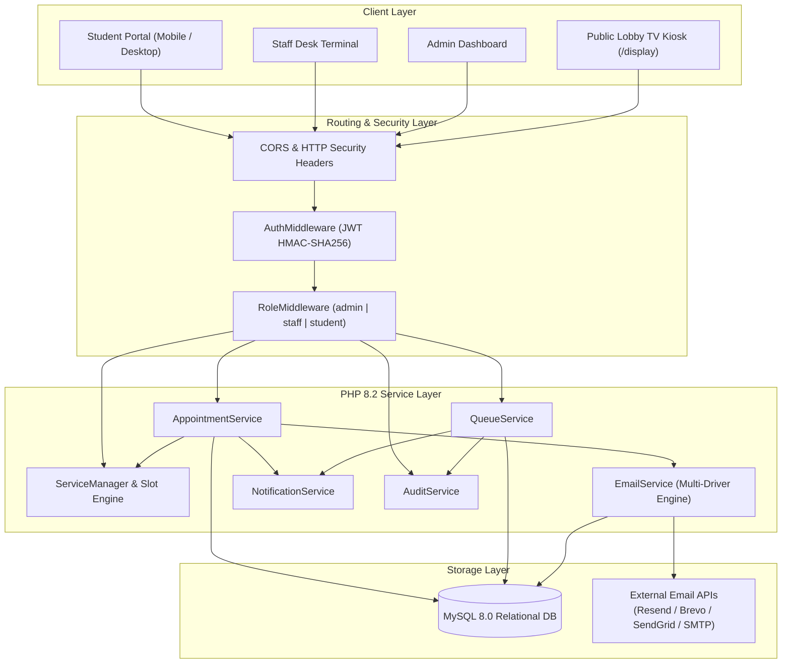
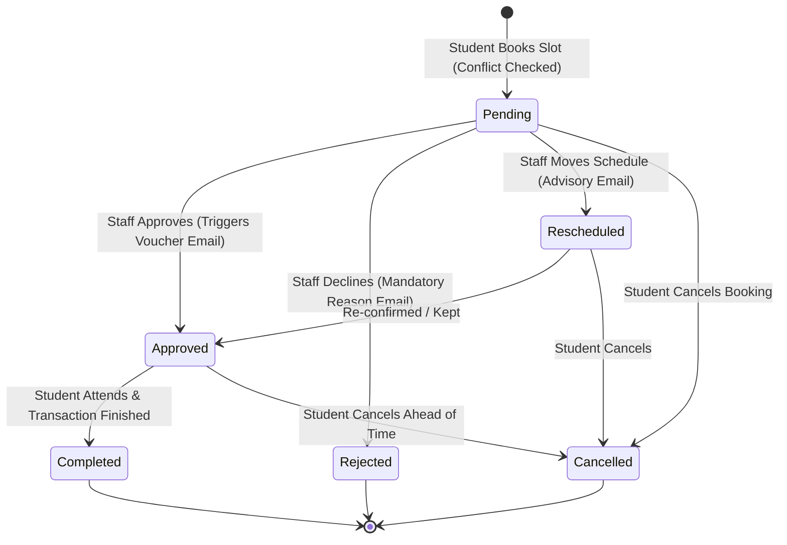
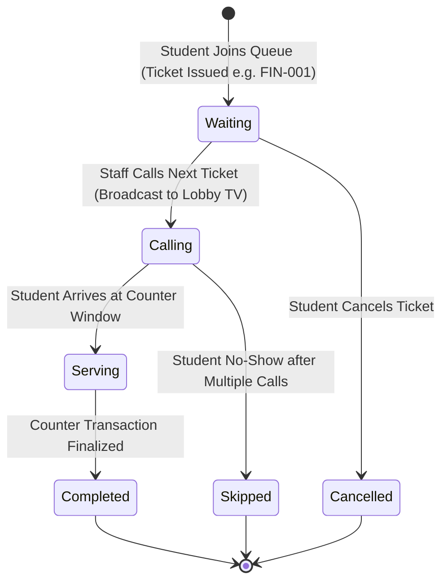

# EduQueue: Master System Architecture, Process Flow & Master Prompt
**St. Rita's College of Balingasag (SRCB) | Higher Education Department**  
**Web-Based Student Service Appointment and Queue Management System**  
*Capstone & Web Systems Project — S.Y. 2025–2026*

---

## 📑 Table of Contents
1. [Executive Summary: What EduQueue Is All About](#1-executive-summary-what-eduqueue-is-all-about)
2. [Core Problem & Solution Matrix](#2-core-problem--solution-matrix)
3. [Dual-Engine Operational Architecture](#3-dual-engine-operational-architecture)
4. [User Roles & Access Control (RBAC)](#4-user-roles--access-control-rbac)
5. [End-to-End System Process Flows](#5-end-to-end-system-process-flows)
   - [5.1 Student Journey: Appointment Booking Flow](#51-student-journey-appointment-booking-flow)
   - [5.2 Student Journey: Walk-in Queue & Live Tracking Flow](#52-student-journey-walk-in-queue--live-tracking-flow)
   - [5.3 Staff Journey: Appointment Disposition & Email Dispatch](#53-staff-journey-appointment-disposition--email-dispatch)
   - [5.4 Staff Journey: Counter Desk Calling & Servicing](#54-staff-journey-counter-desk-calling--servicing)
   - [5.5 Public Lobby Display Monitor Flow](#55-public-lobby-display-monitor-flow)
   - [5.6 Administrator Governance & Analytics Flow](#56-administrator-governance--analytics-flow)
6. [Visual System Flowcharts (Mermaid Diagrams)](#6-visual-system-flowcharts-mermaid-diagrams)
7. [Database Schema & Data Model](#7-database-schema--data-model)
8. [Technology Stack & Architectural Layers](#8-technology-stack--architectural-layers)
9. [Security, Performance & Fail-Safe Design](#9-security-performance--fail-safe-design)
10. [The Master Prompt (AI System Specification & Onboarding Persona)](#10-the-master-prompt-ai-system-specification--onboarding-persona)

---

## 1. Executive Summary: What EduQueue Is All About

**EduQueue** is a full-stack, enterprise-grade academic service management platform engineered specifically for **St. Rita's College of Balingasag (SRCB)**. It unifies two traditionally disjointed institutional workflows into a seamless digital ecosystem:
1. **Scheduled Online Appointments:** For high-touch, consultation-heavy transactions (e.g., Transcript of Records, Dean's Academic Advising, Guidance Counseling, Good Moral Certification).
2. **On-Demand Walk-In Queuing:** For rapid high-volume counter operations (e.g., Tuition & Assessment Payments, ID Validation & RFID activation, Clearance Signing, Library Circulation).

### The Big Picture
Before EduQueue, students faced unpredictable lines, congested corridors outside registrar and cashier windows, double bookings, and communication disconnects when office hours changed. Staff struggled with manual paper logbooks and noisy lobby crowds.

**EduQueue transforms this environment into:**
- A **Self-Service Student Portal** where students discover institutional services, verify prerequisite document checklists, secure conflict-free time slots, or join walk-in queues from their phones with real-time ETA countdowns.
- An **Operational Staff Terminal** giving counter personnel one-click calling controls (`Call Next`, `Start Serving`, `Complete`, `Skip / No-Show`) and an appointment disposition center that automatically fires branded HTML transactional emails.
- A **Lobby Kiosk Display (`/display`)** that broadcasts live counter-by-counter callouts, upcoming waiting ticket queues, and audio alerts on public TV screens.
- An **Executive Admin Panel** featuring real-time KPIs, 7-day throughput analytics, granular service schedule management, user provisioning, and immutable audit/email logging.

---

## 2. Core Problem & Solution Matrix

| Real-World Campus Problem | Manual / Legacy Impact | EduQueue Digital Solution |
| :--- | :--- | :--- |
| **Physical Hallway Congestion** | Students stand for hours outside offices during enrollment and clearance periods. | **Virtual Walk-In Queue** with sequential ticketing (`FIN-001`, `REG-002`) and dynamic position tracking showing exact count of students ahead and estimated wait times. |
| **Double Bookings & Schedule Conflicts** | Lost paper appointment logbooks, students arriving at the same hour for advising or counseling. | **Dynamic Conflict-Free Slot Engine** computing exact available slots based on operating hours, duration, and maximum student limits per slot. |
| **Missed Turns & Lobby Chaos** | Counter staff yelling student names over crowded hallways; students missing their turn if stepping out. | **Lobby TV Display Monitor (`/display`)** + synchronized in-app notification alerts that trigger the instant a ticket is called to a counter window. |
| **Communication Gaps & Wasted Trips** | If an appointment is declined or moved, students discover it only after traveling to campus. | **Automated Transactional Email API** (Resend, Brevo, SendGrid, SMTP) instantly sending HTML vouchers for approvals, reschedule advisories, or rejection justifications. |
| **Lack of Operational Visibility** | Deans and administrators have no data on office turnaround times, peak bottleneck hours, or staff load. | **Administrative Analytics Dashboard** tracking daily throughput, 7-day comparative trends, service utilization charts, and complete audit trails. |

---

## 3. Dual-Engine Operational Architecture

```
                                  ┌──────────────────────────────┐
                                  │      EduQueue Platform       │
                                  └──────────────┬───────────────┘
                                                 │
                     ┌───────────────────────────┴───────────────────────────┐
                     ▼                                                       ▼
       ┌───────────────────────────┐                           ┌───────────────────────────┐
       │   Appointment Engine      │                           │    Walk-In Queue Engine   │
       │  (Scheduled Consultation) │                           │     (Live Counter Desk)   │
       └─────────────┬─────────────┘                           └─────────────┬─────────────┘
                     │                                                       │
      • Time-slot allocation engine                           • Sequential ticket generation
      • Day-of-week operating hours                           • Daily sequence resetting
      • Max student capacity per slot                         • Real-time wait time calculation
      • Automatic conflict checking                           • Staff counter calling terminal
      • Staff approve/decline/reschedule                      • Public lobby display monitor
      • Triggered HTML email vouchers                         • In-app queue turn notification
```

---

## 4. User Roles & Access Control (RBAC)

The system enforces strict role-based access control across three user personas:

### 1. Student (`role: 'student'`)
- Self-register with institutional ID number, name, program, and year level.
- Browse the institutional service catalog with requirement checklists.
- Reserve conflict-free appointment slots and provide transaction notes.
- Join walk-in queues (restricted to one active ticket per service to prevent hoarding).
- View live personal queue progress (ahead count, estimated wait in minutes).
- Receive real-time in-app alerts and transactional email confirmations.
- Manage profile and update account credentials.

### 2. Department Staff (`role: 'staff'`)
- Access staff counter and appointment processing workspaces.
- **Appointment Workbench:** Filter bookings by department, date, and status. Approve requests (triggers email), decline requests (with mandatory justification email), or reschedule slots.
- **Counter Desk Calling Terminal:** Select service and counter window (e.g., `Window 1`, `Cashier 2`); trigger `Call Next Student`, transition to `Start Serving`, mark `Complete`, or record `Skip / No-Show`.
- Update profile and personal account settings.

### 3. System Administrator (`role: 'admin'`)
- Inherits all staff privileges.
- Executive KPI dashboard: Total appointments today, active queue load, completed services, total user base, and 7-day volume comparative charts.
- **Service & Schedule Management:** Create/edit services, toggle active status, set counter locations, define weekly operating schedules (days, hours, slot duration, capacity).
- **User Provisioning:** Create staff and admin accounts, filter users, and toggle account activation status (`active` / `disabled`).
- **Audit & Email Logs:** Inspect immutable system security trails (IP addresses, action tags, metadata) and track email dispatch status.

---

## 5. End-to-End System Process Flows

### 5.1 Student Journey: Appointment Booking Flow
1. **Catalog Exploration:** Student navigates to `/services` or clicks "Book Appointment" on `/dashboard`. Filters services by department (Registrar, Dean's Office, Guidance, etc.).
2. **Service Selection:** Student selects an appointment-based service (e.g., *Transcript of Records Request*). The system verifies that `service_type === 'appointment'` and `is_active === 1`.
3. **Slot Availability Check:** Student selects an upcoming appointment date.
   - Frontend calls `GET /api/services/{id}/slots?date=YYYY-MM-DD`.
   - Backend evaluates `service_schedules` for the target day-of-week.
   - Slices the operating window (e.g., 08:00 to 16:00) into increments of `slot_duration_mins` (e.g., 30 mins).
   - Counts existing active appointments (`pending`, `approved`, `rescheduled`) for each window.
   - Flags each slot as `is_available: true` if `booked_count < max_students_per_slot`.
4. **Conflict Validation:** Student picks an open slot, enters their specific purpose/requirements, and submits `POST /api/appointments`.
   - Backend verifies that the student does not already hold an active appointment for this service on the same date.
   - Verifies the selected slot is not overbooked.
5. **Code Generation:** Backend generates a unique tracking code (e.g., `APT-20261019-A8F2`).
6. **State Creation:** Record is inserted into `appointments` with status `pending`.
7. **Instant Feedback:** An in-app notification is posted to the student's notification drawer; the appointment appears under `/appointments`.

### 5.2 Student Journey: Walk-in Queue & Live Tracking Flow
1. **Queue Request:** Student visits `/services`, selects an on-demand service (e.g., *Tuition & Fees Payment*), and clicks "Join Queue".
2. **Anti-Hoarding & Capacity Check:**
   - Backend verifies `service_type === 'queue'` and `is_active === 1`.
   - Checks if student already has an active ticket (`waiting`, `calling`, `serving`) for this service today. If yes, rejects with HTTP 409.
   - Checks if daily sequence count has exceeded `max_daily_capacity`.
3. **Sequential Ticket Issuance:**
   - Backend queries `MAX(sequence_number) + 1` for today's date.
   - Generates formatted ticket code (e.g., `FIN-001`).
   - Inserts record into `queue_entries` with status `waiting`.
4. **Live Personal Position Tracking:**
   - Student navigates to `/queue` (`MyQueueStatus`).
   - Frontend polls `GET /api/queue/my-active` every 5 seconds.
   - Backend computes:
     - `ahead_in_line`: Number of tickets with status `waiting` and lower sequence numbers for this service today.
     - `estimated_wait_mins`: `(ahead_in_line + 1) * estimated_duration_mins`.
5. **Turn Alert:** When staff calls the ticket, status changes to `calling`. The student's screen flashes with counter window details and an in-app alert chime.

### 5.3 Staff Journey: Appointment Disposition & Email Dispatch
1. **Review Workbench:** Staff logs into `/admin/appointments`, filtering by their department and today's date.
2. **Disposition Decision:**
   - **Scenario A: Approve Appointment**
     - Staff clicks "Approve". Status transitions to `approved`.
     - System dispatches branded HTML email voucher with tracking code, scheduled date/time, office location, and document checklist.
     - In-app notification delivered to student.
   - **Scenario B: Decline Appointment**
     - Staff clicks "Decline" and provides a mandatory reason (e.g., *"Incomplete clearance documents"*).
     - Status transitions to `rejected`.
     - System dispatches official cancellation email detailing the staff's reason.
   - **Scenario C: Reschedule Appointment**
     - Staff selects a revised date, revised time slot, and enters explanatory remarks.
     - Status transitions to `rescheduled`.
     - System dispatches reschedule advisory email with new date/time instructions.
3. **Traceability:** Every dispatch attempt is recorded in `email_logs` (recipient, driver, status, error, payload) without disrupting core database transactions if external APIs fail.

### 5.4 Staff Journey: Counter Desk Calling & Servicing
1. **Terminal Setup:** Staff navigates to `/admin/queue`, selects the active service queue and counter identifier (e.g., `Cashier Counter 1`).
2. **Call Next Student:**
   - Staff clicks **"Call Next Student"** (`POST /api/queue/service/{id}/call-next`).
   - Backend selects the lowest sequence ticket with status `waiting`.
   - Updates status to `calling`, records `counter_number`, `called_by = staff_id`, and `called_at = NOW()`.
   - Instant broadcast reflected on Public Lobby Display (`/display`) and student's personal queue screen.
3. **Start Serving:** When student arrives at the window, staff clicks **"Start Serving"** (`status = 'serving'`, `served_at = NOW()`).
4. **Finalize Transaction:**
   - **Complete:** Student finishes transaction (`status = 'completed'`, `completed_at = NOW()`).
   - **Skip / No-Show:** If student failed to appear after multiple announcements (`status = 'skipped'`).
5. **Analytics Capture:** System stores all timestamps (`called_at`, `served_at`, `completed_at`) to provide accurate office turnaround metrics.

### 5.5 Public Lobby Display Monitor Flow
1. **Kiosk Launch:** Campus monitors open `/display` (public fullscreen route, no login required).
2. **Data Polling:** Page polls `GET /api/public/queue/display` every 5 seconds.
3. **Visual Render:**
   - **Active Serving Grid:** Displays high-contrast cards showing Counter Window, Ticket Number (`FIN-003`), Service Name, and Status Badge (`CALLING` or `SERVING`).
   - **Visual Callout Animation:** Newly called tickets trigger an animated highlight border and audio notification chime.
   - **Upcoming Waiting Ticker:** Summary column displaying total students waiting and next ticket in line for every campus department.
   - **Header:** Live digital clock and institutional SRCB branding.

### 5.6 Administrator Governance & Analytics Flow
1. **Executive Oversight:** Admin navigates to `/admin/dashboard` to view real-time operations, throughput cards, and 7-day comparative traffic graphs.
2. **Service Configuration (`/admin/services`):**
   - Create new services or update existing ones.
   - Define classification (`appointment` vs `queue`), office counter, estimated duration, and prerequisite list.
   - Configure weekly schedule matrix (`service_schedules`): assign operating days (Mon–Fri), time windows (e.g., 08:00–16:00), slot duration (15/30/45 mins), and maximum capacity per slot.
3. **User Management (`/admin/users`):**
   - Provision staff personnel and administrators.
   - Toggle account status to immediately disable compromised accounts.
4. **Audit Trail & Mail Monitoring (`/admin/audit`):**
   - Search security logs: logins, status changes, service modifications, and client IP addresses.
   - Inspect transactional email delivery logs (sent, failed, provider response).

---

## 6. Visual System Flowcharts (Mermaid Diagrams)

### 6.1 High-Level Architecture & Interaction Overview



### 6.2 Appointment Lifecycle State Machine



### 6.3 Walk-In Queue Lifecycle State Machine



---

## 7. Database Schema & Data Model

The backend is backed by an indexed, normalized relational schema (`student_services_db`):

| Table Name | Primary Purpose | Key Fields | Foreign Keys / Relations |
| :--- | :--- | :--- | :--- |
| **`users`** | Identity, authentication, and RBAC | `id`, `student_id_number`, `email`, `password_hash`, `role`, `department_or_course`, `year_level`, `is_active` | None (Root entity) |
| **`services`** | Institutional service catalog | `id`, `code`, `name`, `service_type` (`appointment`\|`queue`), `location_or_counter`, `estimated_duration_mins`, `max_daily_capacity`, `requirements`, `is_active` | None (Referenced by schedules, appointments, queues) |
| **`service_schedules`** | Weekly timetable for appointment slots | `id`, `service_id`, `day_of_week` (0-6), `start_time`, `end_time`, `slot_duration_mins`, `max_students_per_slot`, `is_active` | `service_id` → `services(id)` ON DELETE CASCADE |
| **`appointments`** | Scheduled student service bookings | `id`, `appointment_code`, `user_id`, `service_id`, `appointment_date`, `start_time`, `end_time`, `purpose`, `status`, `admin_notes`, `rejection_reason`, `processed_by` | `user_id` → `users(id)`, `service_id` → `services(id)`, `processed_by` → `users(id)` |
| **`queue_entries`** | Daily walk-in queue tickets | `id`, `queue_number`, `user_id`, `service_id`, `queue_date`, `sequence_number`, `status`, `counter_number`, `called_by`, `called_at`, `served_at`, `completed_at` | `user_id` → `users(id)`, `service_id` → `services(id)`, `called_by` → `users(id)` |
| **`notifications`** | In-app user alert messages | `id`, `user_id`, `title`, `message`, `type` (`appointment`\|`queue`\|`system`), `related_id`, `is_read`, `created_at` | `user_id` → `users(id)` ON DELETE CASCADE |
| **`email_logs`** | Transactional email audit monitor | `id`, `recipient_email`, `recipient_name`, `subject`, `template`, `payload_json`, `status` (`sent`\|`failed`), `error_message`, `external_message_id` | Standalone audit entity |
| **`audit_logs`** | Security and compliance activity trail | `id`, `user_id`, `action`, `entity_type`, `entity_id`, `details_json`, `ip_address`, `created_at` | `user_id` → `users(id)` ON DELETE SET NULL |

---

## 8. Technology Stack & Architectural Layers

### Frontend Architecture
- **Framework:** React 18 with TypeScript and Vite.
- **Styling:** Vanilla Tailwind CSS with custom academic palette (Navy `#1E3A8A`, Royal Blue `#2563EB`, Emerald `#10B981`, Amber `#F59E0B`, Rose `#EF4444`, Slate `#F8FAFC`).
- **Icons:** Lucide React for consistent UI semantics.
- **Routing:** React Router v6 with `ProtectedRoute` guards and role-based redirects.
- **State & Communication:** `AuthContext` (JWT session persistence), `NotificationContext` (interval polling for notifications and queue shifts), and typed HTTP client (`src/services/api.ts`).

### Backend Architecture
- **Language:** Native PHP 8.2+ without bloated external frameworks to ensure maximum performance, maintainability, and compatibility.
- **Pattern:** Layered Architecture:
  - `Core/`: Custom micro-router (`Router.php`), HTTP Request/Response parsers (`Request.php`, `Response.php`), Database wrapper with persistent PDO (`Database.php`), JWT generator/verifier (`JWT.php`), and Environment reader (`Env.php`).
  - `Middleware/`: `CorsMiddleware`, `AuthMiddleware` (JWT validation), `RoleMiddleware` (RBAC authorization).
  - `Controllers/`: HTTP parsing, validation, and serialization.
  - `Services/`: Business logic, transaction orchestration, and third-party integrations (`AppointmentService`, `QueueService`, `ServiceManager`, `EmailService`, `NotificationService`, `AuditService`).

### Production Deployment Stack
- **OS:** Ubuntu Server 22.04 / 24.04 LTS.
- **Web Server:** Nginx as Reverse Proxy and Static File Server.
- **PHP Process Manager:** PHP-FPM 8.2 / 8.3 with Unix sockets.
- **Security:** UFW Firewall, OpenSSH, Let's Encrypt SSL/TLS.

---

## 9. Security, Performance & Fail-Safe Design

1. **SQL Injection Prevention:** 100% of database queries execute through PDO prepared statements with parameter binding. Emulated prepares are strictly disabled (`PDO::ATTR_EMULATE_PREPARES = false`).
2. **Password Security:** Hashes generated with standard `PASSWORD_BCRYPT` (cost factor 10). Plaintext passwords are never stored, transmitted, or logged.
3. **Stateless JWT Authorization:** Client requests attach `Authorization: Bearer <token>`. Tokens are HMAC-SHA256 verified on every protected route.
4. **Isolated Credentials:** All secrets (database passwords, JWT secret keys, third-party mail API keys) exist solely in `.env` and are never bundled into client code.
5. **Fail-Safe Transactional Emailing:** Email sending runs in a `try-catch` wrapper that logs to `email_logs`. If the external email service experiences network downtime, the underlying appointment status update or queue operation is **never** rolled back.
6. **Optimized Real-Time Polling:** Public display and queue trackers utilize lightweight 5-second REST polling queries targeting indexed columns (`queue_date`, `status`, `sequence_number`), ensuring sub-10ms database execution times.

---

## 10. The Master Prompt (AI System Specification & Onboarding Persona)

> *Below is the complete, self-contained Master Prompt. You can copy-paste this prompt into any AI model, code generator, or technical brief to provide full context on how the system is structured, how it behaves, and how to extend it.*

```markdown
# MASTER PROMPT: EduQueue Academic Service Appointment & Queue System

You are the Lead Systems Architect and Senior Full-Stack Engineer for "EduQueue", an enterprise web-based student service appointment and queue management system developed for St. Rita's College of Balingasag (SRCB).

### SYSTEM OVERVIEW & IDENTITY
- Target Institution: St. Rita's College of Balingasag (SRCB), Misamis Oriental, Philippines.
- Project Name: EduQueue (Web-Based Student Service Appointment and Queue Management System).
- Purpose: Unify scheduled appointment booking and on-demand walk-in queue management into a single responsive web platform with automated transactional email alerts, staff desk calling terminals, and public lobby TV displays.

### ARCHITECTURAL RULES & TECH STACK
1. Frontend: React 18, TypeScript, Vite, Tailwind CSS, Lucide Icons, React Router v6.
2. Backend: PHP 8.2+ RESTful API following MVC + Service Layer patterns. No external bloated framework dependencies.
3. Database: MySQL 8.0, normalized relational schema, PDO prepared statements (`PDO::ATTR_EMULATE_PREPARES = false`), InnoDB foreign keys and cascading rules.
4. Authentication: Stateless JWT (HMAC-SHA256) with Bearer token header injection and BCrypt password hashing.
5. Role-Based Access Control (RBAC):
   - 'student': Self-service portal (`/dashboard`, `/services`, `/appointments`, `/queue`, `/profile`).
   - 'staff': Counter desk terminal & appointment disposition (`/admin/appointments`, `/admin/queue`, `/profile`).
   - 'admin': Full system governance (`/admin/dashboard`, `/admin/services`, `/admin/users`, `/admin/audit`).
6. Public Route:
   - `/display`: Fullscreen Lobby TV Kiosk monitor polling every 5s with audio chime and split-counter cards.

### CORE BUSINESS LOGIC & CONSTRAINTS
1. Dual Service Classification:
   - Every service is either `appointment` or `queue`.
   - Appointment services have operating schedules in `service_schedules` specifying day_of_week, start_time, end_time, slot_duration_mins, and max_students_per_slot.
   - Queue services issue daily sequential codes with service prefixes (e.g., `FIN-001`, `REG-002`) resetting daily.
2. Conflict Prevention:
   - Students cannot book appointments in the past or on non-operating days.
   - Students cannot have more than one active appointment for the same service on the same date.
   - Slot booking checks active bookings against `max_students_per_slot`.
   - Students cannot hold more than one active queue ticket (`waiting`, `calling`, `serving`) per service at a time.
   - Queue entries cannot exceed `max_daily_capacity`.
3. State Lifecycles:
   - Appointments: `pending` -> `approved` / `rejected` / `rescheduled` -> `completed` / `cancelled`.
   - Queue Tickets: `waiting` -> `calling` -> `serving` -> `completed` / `skipped` / `cancelled`.
4. Transactional Email Dispatch:
   - Triggered on appointment approval, decline (with mandatory reason), and rescheduling.
   - Supports drivers: Resend, Brevo, SendGrid, SMTP, and local log driver.
   - Fail-safe: Email delivery failures are recorded in `email_logs` and never break or roll back the primary database transaction.
5. Performance & Auditing:
   - Key fields indexed for sub-10ms queries.
   - All critical actions logged in `audit_logs` with user ID, action tag, entity type, entity ID, and client IP.

### YOUR BEHAVIOR & GUIDELINES
When writing code, debugging, or designing features for EduQueue:
- Always preserve TypeScript type safety and full interface definitions.
- Always use PDO prepared statements with named parameters for any SQL query.
- Maintain the established academic UI theme (Navy `#1E3A8A`, Royal Blue `#2563EB`, Emerald `#10B981`, Amber `#F59E0B`, Rose `#EF4444`, Slate `#F8FAFC`).
- Ensure all API endpoints return standardized JSON (`Response::json(['success' => true, 'data' => ...])` or `Response::error($message, $code)`).
- Provide clean, accessible, and intuitive user experiences with high visual polish.
```

---
*EduQueue Documentation & Master Prompt — Maintained by Group 2 Capstone Development Team, St. Rita's College of Balingasag, Inc.*
